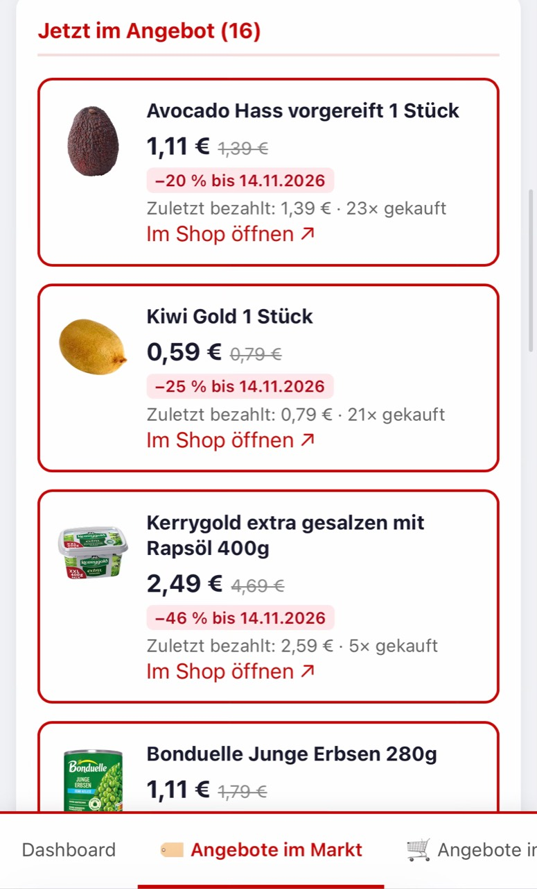

# REWE eBon Analyse

Lokales Analyse-Tool für REWE eBon-Kassenbons (EML mit PDF-Anhang).
Erstellt einen interaktiven HTML-Bericht aus den eigenen Einkaufsdaten.

## Neu: Angebote passend zu den eigenen Einkäufen

Die Reiter **Angebote im Markt** und **Angebote im Onlineshop** zeigen, welche
bereits gekauften Artikel gerade reduziert sind. Auch einmal gekaufte Artikel
werden berücksichtigt. eBons des ausgewählten Markts werden mit dessen
Abholsortiment abgeglichen, Online-Rechnungen mit dem Lieferservice.

Jede Angebotskarte zeigt Produktbild, Angebotspreis und bisherigen regulären
Preis, Rabatt, Gültigkeitsdatum sowie den zuletzt bezahlten Preis und die eigene
Kaufanzahl. Über **Im Shop öffnen** geht es zur zugeordneten REWE-Produktvariante.
Unterschiedliche Bon-Bezeichnungen für dieselbe Produkt-ID werden bei gleichen
Angebotskonditionen in einer Karte zusammengefasst. Die Kaufanzahl wird addiert;
der zuletzt bezahlte Preis stammt aus dem jüngsten zugehörigen Kauf.



### Sonntags für die kommende Woche

Ein eigener **macOS-Hintergrundjob ruft jeden Sonntag um 18:00 Uhr** die
Angebotslisten für Markt und Lieferservice für die kommende Woche ab. Der Abruf
läuft direkt mit Python, auch wenn die App und der Browser geschlossen sind.
Die Gültigkeitsdaten stehen auf den jeweiligen Angebotskarten.

Der Angebotskatalog selbst enthält keine persönlichen Artikelnamen; er wird
seitenweise geladen und **lokal** mit den Käufen abgeglichen. Bremst REWE den
Abruf (HTTP 429/403), bleibt der Fortschritt gespeichert und die **Nachtläufe um
1:30, 3:00 und 4:30 Uhr** setzen ab der unterbrochenen Seite fort. Erst nach
vollständigem Abruf beider Kanäle wird der Angebotsstand atomar gespeichert und
der Bericht neu erzeugt. Die bestehende Veröffentlichung zeigt ihn auch in der
passwortgeschützten Online-Fassung.

Damit Angebote auch bei stark abgekürzten Bon-Namen sicher erkannt werden, sucht
jeder Lauf zusätzlich bis zu 60 gekaufte Namen einzeln in der REWE-Produktsuche
und merkt sich die gefundene **Produkt-ID** (`rewe_product_map.json`). Diese
Suche überträgt – wie die manuelle Prüfung – die betreffenden Artikelnamen an
REWE, langsam (ein Abruf alle 3 Sekunden) und in Portionen über die Nacht
verteilt. Ein Angebot eines zugeordneten Artikels wird danach unabhängig von der
Schreibweise auf dem Bon erkannt. Namen ohne sicheren Treffer werden nach 30
Tagen erneut gesucht.

Abgelaufene Treffer bleiben unter **Zuletzt erfasste Angebote** mit ihrem damaligen
Preis sichtbar. Ein fehlender Angebotstreffer ist keine Aussage über die
Verfügbarkeit im Marktregal. Die zusätzliche manuelle Einzelprüfung startet nur
nach einem Klick in der lokalen App und sendet die betreffenden Artikelnamen an
REWE.

`./install.sh` richtet den Angebotsjob zusammen mit den bestehenden REWE-Jobs
ein. Nur den Angebotsjob (Sonntag + Nachtläufe) installieren oder aktualisieren:

```bash
python3 scripts/install-offer-job.py
```

Der Job `com.marc.rewe-offers` verwendet die lokale Mac-Zeit (im eingerichteten
Betrieb Europe/Berlin). Der Mac muss eingeschaltet und der Benutzer angemeldet
sein. Protokolle liegen unter `~/Library/Logs/rewe-offers.log` und
`~/Library/Logs/rewe-offers-error.log`.

Einmaliger manueller Abruf (Katalog sofort, plus bis zu 60 Namenssuchen):

```bash
python3 rewe_offer_refresh.py
```

Nur den Katalog abrufen, ohne Namen an REWE zu senden:

```bash
python3 rewe_offer_refresh.py --map-limit 0
```

Das Log zeigt je Kanal, wie viele Artikel per Produkt-ID bzw. per Namensvergleich
als Angebot erkannt wurden und wie viele noch nicht gesucht oder nicht sicher
zugeordnet sind.

Details zu Kanälen, Zuordnung, Gültigkeit und Fehlerbehandlung:
[README_API.md](README_API.md).

### Mobile Bedienung

- Das Dashboard passt sich schmalen Bildschirmen an; Kennzahlen stehen mobil in zwei Spalten.
- Breite Tabellen scrollen innerhalb ihrer Karten, ohne die gesamte Seite zu verbreitern.
- Bis 600 Pixel Bildschirmbreite bleibt die Navigation **unten am Bildschirmrand**, mit Platz für den sicheren Bildschirmbereich.
- Beim Wechsel des App-Reiters beginnt die neue Seite **immer oben**, auch beim Zurückwechseln.
- **Abmelden** bleibt in der Kopfzeile und verdeckt beim Scrollen keine Navigation.

### Weitere Ansichten

<details>
<summary>Dashboard und Preisentwicklung ansehen</summary>


</details>

## Version 1.0

Diese Version bringt zahlreiche neue Funktionen und einen aufgeräumten Tab-Aufbau:

- 🛒 **Einkaufszettel** als eigener Reiter — Karten mit Kategorie-Emoji, Vorschläge unten, gewählte Artikel oben (klickbar nach oben/unten), eigene Einträge per "Ich brauche…", Liste leeren, Kopieren, Drucken
- 📅 **Haltbarkeit & Wochenverbrauch** — wie lange hält 1 Einheit, was geht pro Woche durch (Stück + kg vereint, Gruppen aufklappbar)
- 🏷 **Kategorie pro Artikel manuell anpassen** — Klick auf Badge in "Alle Positionen", Override gilt für alle gleichlautenden Artikel (gespeichert in `categories_override.json`)
- 🧹 **Artikelnamen-Bereinigung** — REWE-Markt-GmbH-Footer und zusammengeklebte Gewichtsartikel werden automatisch gesäubert
- 📊 **Aufgeräumter Tab-Aufbau**: Statistiken-Reiter aufgelöst — Wochentage und Bonus jetzt im Dashboard, Preis-Alarm und Inflation in Preisentwicklung
- 🔢 **Deutsche Tausendertrennung** in allen Charts und Tabellen
- 🌱 **Saisonale Muster normalisiert** — Werte über mehrere Jahre werden gemittelt, sodass Saisons mit doppelter Datenabdeckung nicht überrepräsentiert sind
- 🛍 **REWE Shop (Lieferservice) Import** zusätzlich zu eBon-Mails

## Features

- 📊 **Dashboard** – Monatsausgaben, Jahresübersicht, Top-30-Artikel (Häufigkeit & Ausgaben), Kategorien, Wochentag-Analyse, Bonus-Guthaben & Bonus-Rate, Saisonale Muster (normalisiert), Monatsforecast
- 📈 **Preisentwicklung** – Preishistorie einzelner Artikel, Größte Preisschwankung & Stabilste Preise mit Min/Max/Letzt/Käufe-Angabe, Kürzlich gestiegen, Preis-Alarm, Inflations-Tabelle
- 🛒 **Einkaufszettel** – Auto-Vorschläge basierend auf Wochenverbrauch & Kaufintervall, Karten-Layout, eigene Einträge, Kopieren/Drucken
- 🥦 **Verbrauch** – Haltbarkeit & Wochenverbrauch (Stück + kg vereint), Jahresverbrauch in kg und Stückzahlen, Wiederbestellungs-Prognose, Gruppen aufklappbar
- 🗂 **Alle Positionen** – Suchbar & sortierbar; Kategorie pro Artikel klickbar änderbar; €/kg für Gewichtsartikel; Menge in Gramm
- 🧾 **Alle Belege** – Aufklappbar mit Detailansicht, direkter PDF-Link
- 🏷 **Artikel-Gruppen** – Ähnliche Artikel zusammenfassen (z. B. alle Bananen-Varianten), direkt im Browser editierbar; Gruppierungen wirken auf Dashboard, Verbrauch und Warenkorbanalyse
- 🤖 **Automatischer Mail-Import** – Neue eBons aus dem Ordner „Rewe“ und Lieferdienst-Rechnungen aus dem Posteingang werden automatisch exportiert und verarbeitet (via launchd + AppleScript)
- 🏷 **Angebote nach Einkaufsart** – Automatischer Katalogabgleich für Markt und Lieferservice mit Produktbildern, Preisvergleich, Rabatt und Gültigkeit; im eingerichteten Betrieb sonntags für die kommende Woche. Zusätzliche manuelle Einzelprüfung mit Fortschritt und Abbruch in der lokalen App.

## Voraussetzungen

```bash
pip install pdfplumber
```

Python 3.9+ wird benötigt.

## Nutzung

### Einfachster Weg: Doppelklick
→ `Auswertung starten.command` im Finder doppelklicken

Startet die Auswertung, öffnet den Report im Browser **und** den lokalen Server,
damit Gruppen- und Kategorie-Änderungen aus dem Browser heraus persistiert werden können.

### Per Terminal
```bash
cd Rewe/
python3 rewe_analyze.py          # Auswertung + Report generieren
python3 rewe_analyze.py --serve  # wie oben + Browser öffnen + Server starten
```

### Neue Kassenbons hinzufügen

**Option A – EML (aus Apple Mail):**
1. eBon-Mail in Apple Mail öffnen
2. *Ablage → Als Datei sichern…* → `.eml`-Datei in den `import/`-Ordner legen
3. `Auswertung starten.command` doppelklicken

**Option B – Direkte PDF:**
1. PDF-Datei direkt in den `import/`-Ordner legen
2. `Auswertung starten.command` doppelklicken

Das Skript erkennt automatisch neue EML- und PDF-Dateien, verarbeitet nur diese
und **löscht sie danach automatisch** aus dem `import/`-Ordner.

## Daten und Ordnerstruktur

Code, Dokumentation und Screenshot liegen im Repository. Persönliche Daten
liegen standardmäßig unter `~/Library/Application Support/Rewe`; ein anderer
Datenordner kann über `REWE_DATA_DIR` gewählt werden. `import/` und `pdfs/`
beziehen sich auf diesen Datenordner.

```text
~/Library/Application Support/Rewe/
├── import/                       ← EML- oder PDF-Dateien hier ablegen
├── pdfs/                         ← auto-extrahierte PDFs (wird auto-erstellt)
├── rewe_ebons.db                 ← Datenbank (wird auto-erstellt)
├── rewe_report.html              ← Bericht (wird auto-erstellt)
├── groups.json                   ← Artikel-Gruppen (wird im Browser gespeichert)
├── categories_override.json      ← Kategorie-Overrides (wird im Browser gespeichert)
├── rewe_offer_snapshot.json      ← letzter vollständiger Angebotsstand
├── rewe_offer_catalogue.json     ← zuletzt vollständig geladene Angebotskataloge
├── rewe_offer_progress.json      ← Zwischenstand eines unterbrochenen Abrufs
└── rewe_product_map.json         ← gelernte Zuordnung Bon-Name → REWE-Produkt-ID
```

> **Hinweis:** `import/`, `pdfs/`, `rewe_ebons.db`, `rewe_report.html`,
> `groups.json`, `categories_override.json`, `rewe_offer_*.json` und `rewe_product_map.json` enthalten persönliche Daten
> und sind in `.gitignore` ausgeschlossen.

## Datenmodell

- `rewe_ebons.db` – SQLite mit zwei Tabellen: `receipts` (Kassenbons) und `items` (Positionen)
- `groups.json` – Mapping `Gruppenname → [Artikelname, …]` für Zusammenfassungen
- `categories_override.json` – Mapping `Artikelname → Kategorie` für manuelle Korrekturen

Beide JSON-Dateien werden vom lokalen Server bei Änderungen im Browser geschrieben
(`--serve`-Modus erforderlich).

## Prüfungen

```bash
python3 -m unittest discover -s tests
node --test tests/rewe_offer_state.test.cjs
```

Die Tests verwenden temporäre Daten beziehungsweise synthetische Beispiele.

---

*Dieses Projekt steht in keiner Verbindung zur REWE Group. „REWE" und „eBon" sind Marken der REWE Group.*
